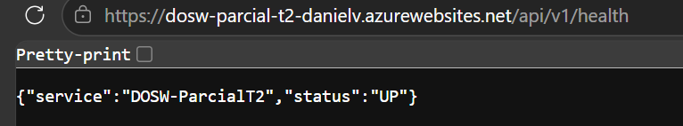
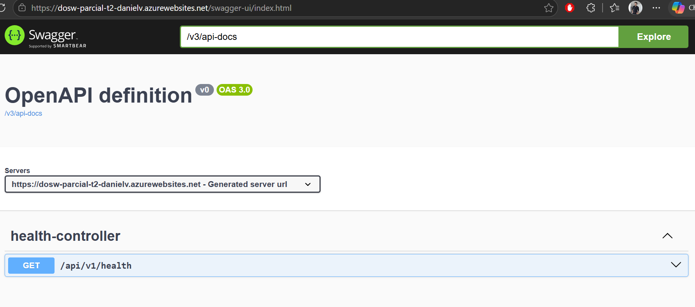
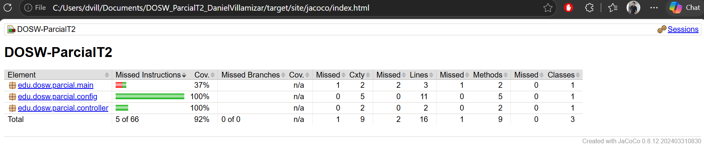
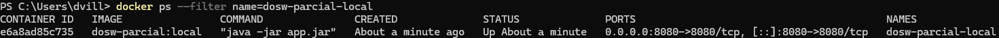
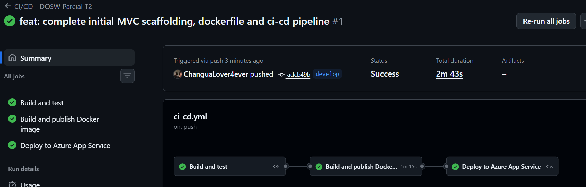
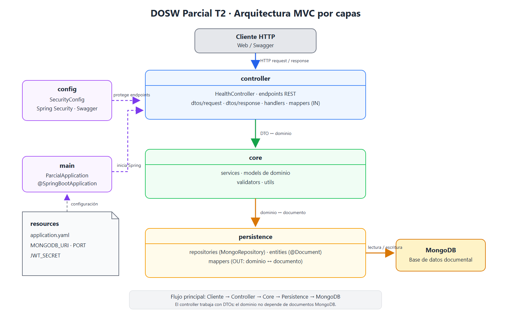

# DOSW_ParcialT2_DanielVillamizar

Servicio base para el Parcial Práctico del Segundo Tercio de Desarrollo Orientado a Software (DOSW). El proyecto usa Spring Boot y MongoDB, y deja preparada la estructura MVC, el endpoint de salud, la documentación OpenAPI y el pipeline de construcción y despliegue.

## Índice

1. [Datos del estudiante](#1-datos-del-estudiante)
2. [Descripción del proyecto](#2-descripción-del-proyecto)
3. [Despliegue](#3-despliegue)
4. [Estructura del proyecto](#4-estructura-del-proyecto)
5. [Tecnologías y dependencias](#5-tecnologías-y-dependencias)
6. [Configuración y variables de entorno](#6-configuración-y-variables-de-entorno)
7. [Cómo ejecutar](#7-cómo-ejecutar)
8. [Pruebas](#8-pruebas)
9. [Docker](#9-docker)
10. [CI/CD](#10-cicd)
11. [Herramientas de modelado y diseño (evidencias)](#11-herramientas-de-modelado-y-diseño-evidencias)
12. [Comandos para clonar y trabajar en otro equipo](#12-comandos-para-clonar-y-trabajar-en-otro-equipo)

## 1. Datos del estudiante

| Dato | Valor |
|---|---|
| Nombre completo | Daniel José Villamizar Castellanos |
| Grupo | DOSW |
| Repositorio | [DOSW_ParcialT2_DanielVillamizar](https://github.com/ChanguaLover4ever/DOSW_ParcialT2_DanielVillamizar) |
| Rama de trabajo | `develop` |

## 2. Descripción del proyecto

Este repositorio contiene el esqueleto de un servicio REST para el parcial práctico de DOSW. Está construido con Spring Boot y preparado para usar MongoDB. Actualmente incluye un endpoint público de salud, configuración inicial de seguridad y acceso a Swagger; las funcionalidades del dominio se desarrollarán durante el parcial.

## 3. Despliegue

| Recurso | URL |
|---|---|
| Aplicación en Azure | [https://dosw-parcial-t2-danielv.azurewebsites.net](https://dosw-parcial-t2-danielv.azurewebsites.net) |
| Health | [https://dosw-parcial-t2-danielv.azurewebsites.net/api/v1/health](https://dosw-parcial-t2-danielv.azurewebsites.net/api/v1/health) |
| Swagger UI | [https://dosw-parcial-t2-danielv.azurewebsites.net/swagger-ui/index.html](https://dosw-parcial-t2-danielv.azurewebsites.net/swagger-ui/index.html) |

El endpoint de health debe responder HTTP 200 y Swagger debe cargar desde la URL pública antes de marcar el despliegue como listo.

Capturas de verificación del servicio desplegado:

| Health responde | Swagger UI |
|---|---|
|  |  |

## 4. Estructura del proyecto

```text
.
├── .github/workflows/ci-cd.yml
├── docs/
│   ├── images/                 # Capturas y exportes para este README
│   └── uml/                    # Fuentes editables de diagramas
├── src/
│   ├── main/
│   │   ├── java/edu/dosw/parcial/
│   │   │   ├── config/         # Configuración de seguridad
│   │   │   ├── controller/     # Controladores HTTP
│   │   │   ├── core/           # Dominio, servicios, validadores y utilidades
│   │   │   ├── main/           # Aplicación Spring Boot
│   │   │   └── persistence/    # Persistencia MongoDB
│   │   └── resources/
│   │       └── application.yaml
│   └── test/
│       ├── java/edu/dosw/parcial/
│       │   ├── controller/
│       │   ├── core/
│       │   └── persistence/
│       └── resources/
├── .dockerignore
├── .gitignore
├── Dockerfile
├── pom.xml
└── README.md
```

Los paquetes `controller/mappers` y `persistence/mappers` separan la conversión entre DTOs, dominio y documentos MongoDB. Los directorios que aún no tienen clases contienen `.gitkeep` para que Git conserve el scaffold.

## 5. Tecnologías y dependencias

| Tecnología | Versión | Uso |
|---|---:|---|
| Java | 21 | Lenguaje y runtime del servicio |
| Spring Boot | 3.3.4 | Aplicación web y configuración |
| Spring Web | BOM de Spring Boot | API REST |
| Spring Data MongoDB | BOM de Spring Boot | Acceso a MongoDB |
| Spring Security | BOM de Spring Boot | Protección de endpoints |
| Spring Validation | BOM de Spring Boot | Validación de datos de entrada |
| JJWT | 0.12.3 | Soporte para JSON Web Tokens |
| Springdoc OpenAPI | 2.5.0 | Documentación y Swagger UI |
| Lombok | 1.18.40 | Reducción de código repetitivo y anotaciones |
| MapStruct | 1.5.5.Final | Mapeo entre objetos |
| Maven | 3.9 o compatible | Gestión de dependencias y build |
| JaCoCo | 0.8.12 | Reporte de cobertura de pruebas |
| Sonar Maven Plugin | 3.10.0.2594 | Integración con análisis SonarQube |
| Docker | 29 o compatible | Empaquetado y ejecución del servicio |
| GitHub Actions | — | Build, pruebas, publicación y despliegue |

Las dependencias y plugins se declaran en [`pom.xml`](pom.xml).

## 6. Configuración y variables de entorno

La aplicación lee la configuración desde `src/main/resources/application.yaml`. La URI local de MongoDB tiene un valor por defecto; el secreto JWT se debe proporcionar al ejecutar el servicio.

| Variable | Descripción | Ejemplo no sensible |
|---|---|---|
| `MONGODB_URI` | URI de la instancia MongoDB | `mongodb://localhost:27017/dosw_parcial` |
| `JWT_SECRET` | Secreto JWT codificado en Base64 (mínimo 44 caracteres) | `<secreto-base64-local>` |
| `PORT` | Puerto HTTP de la aplicación; valor por defecto `8080` | `8080` |
| `WEBSITES_PORT` | Puerto que Azure App Service debe enrutar al contenedor | `8080` |

No agregues los valores reales de estas variables a Git, al README, a capturas o a archivos de configuración versionados. En GitHub, configura como Actions secrets `JWT_SECRET`, `DOCKERHUB_USERNAME`, `DOCKERHUB_TOKEN`, `AZURE_CREDENTIALS` y `AZURE_WEBAPP_NAME`. Configura `MONGODB_URI`, `JWT_SECRET` y `WEBSITES_PORT` en los ajustes de entorno del App Service.

## 7. Cómo ejecutar

Requisitos locales: JDK 21, Maven y Docker. Para ejecutar la aplicación con MongoDB local, primero levanta una instancia:

```powershell
docker run -d --name mongo-parcial -p 27017:27017 mongo:7
```

En PowerShell, establece un secreto local (no lo guardes en el repositorio) y arranca la aplicación:

```powershell
$env:JWT_SECRET = "<tu-secreto-base64-de-al-menos-44-caracteres>"
mvn spring-boot:run
```

Para compilar y ejecutar las pruebas:

```powershell
mvn clean verify
```

Cuando termine el arranque, comprueba `http://localhost:8080/api/v1/health`. Swagger UI está disponible en `http://localhost:8080/swagger-ui/index.html`.

## 8. Pruebas

Las pruebas se ejecutan con JUnit y Mockito, incluidos en `spring-boot-starter-test`. El test actual verifica la respuesta HTTP del endpoint de health con MockMvc.

```powershell
mvn test
```

Para generar también el reporte JaCoCo:

```powershell
mvn clean verify
```

El reporte HTML se genera en `target/site/jacoco/index.html`. Se ejecutó `mvn clean verify` y pasó `HealthControllerTest`. La captura del resumen actual de JaCoCo está aquí:



La cobertura actual corresponde al scaffold y a la prueba del endpoint de health; no representa todavía cobertura de funcionalidades del dominio.

## 9. Docker

Construye la imagen desde la raíz del repositorio:

```powershell
docker build -t dosw-parcial:local .
```

En Docker Desktop para Windows, si MongoDB está corriendo como contenedor publicado en el host, configura `host.docker.internal` como host de MongoDB:

```powershell
$env:JWT_SECRET = "<tu-secreto-base64-de-al-menos-44-caracteres>"
docker run --rm -p 8080:8080 `
  -e "JWT_SECRET=$env:JWT_SECRET" `
  -e "MONGODB_URI=mongodb://host.docker.internal:27017/dosw_parcial" `
  dosw-parcial:local
```

Verifica `http://localhost:8080/api/v1/health`. El `.dockerignore` excluye del contexto de build archivos locales, documentación y posibles credenciales.

Captura del contenedor ejecutándose localmente:



## 10. CI/CD

El workflow [`.github/workflows/ci-cd.yml`](.github/workflows/ci-cd.yml) se ejecuta en pushes a `main` o `develop`, y también permite ejecución manual. Sus trabajos, en orden, verifican el proyecto con Java 21 y `mvn verify`, construyen y publican la imagen en Docker Hub (`latest` y el SHA del commit), y despliegan `latest` en Azure App Service.

Configura estos **Actions secrets** en `Settings → Secrets and variables → Actions`:

| Secret | Contenido |
|---|---|
| `DOCKERHUB_USERNAME` | Usuario de Docker Hub |
| `DOCKERHUB_TOKEN` | Access token de Docker Hub |
| `AZURE_CREDENTIALS` | JSON de credenciales del Service Principal de Azure |
| `AZURE_WEBAPP_NAME` | Nombre del Azure App Service |
| `JWT_SECRET` | Secreto JWT codificado en Base64 |

En el App Service configura, además, las variables de aplicación `MONGODB_URI`, `JWT_SECRET` y `WEBSITES_PORT=8080`. El repositorio y la imagen no deben contener credenciales.

Evidencia de la ejecución del pipeline:



## 11. Herramientas de modelado y diseño (evidencias)

Herramienta de modelado seleccionada: Draw.io. Herramienta de diseño de interfaces: Figma.

El diagrama de arquitectura MVC está generado y disponible en formato editable y exportado:

- [Archivo editable de Draw.io](docs/uml/diagram-mvc.drawio)
- [Exportación SVG](docs/images/diagram-mvc.svg)



Agrega también capturas que evidencien el acceso a tu cuenta de modelado y a Figma, sin exponer información privada o credenciales:

- Evidencia de acceso a la herramienta de modelado: `docs/images/cuenta-modelado.png` (pendiente).
- Evidencia de acceso a Figma: `docs/images/cuenta-figma.png` (pendiente).

## 12. Comandos para clonar y trabajar en otro equipo

Requisitos: Git, JDK 21, Maven y Docker Desktop instalado y en ejecución. En PowerShell, clona el repositorio y cambia a la rama de trabajo:

```powershell
git clone https://github.com/ChanguaLover4ever/DOSW_ParcialT2_DanielVillamizar.git
cd DOSW_ParcialT2_DanielVillamizar
git switch develop
git pull origin develop
```

Comprueba el proyecto y las pruebas:

```powershell
mvn clean verify
```

Para ejecutar el servicio dentro de Docker, primero construye la imagen y levanta MongoDB:

```powershell
docker build -t dosw-parcial:local .
docker run -d --name mongo-parcial -p 27017:27017 mongo:7
```

Genera un secreto JWT temporal para esta sesión de PowerShell e inicia el servicio. No escribas el valor del secreto en un archivo versionado:

```powershell
[byte[]]$bytes = New-Object byte[] 32
$rng = [System.Security.Cryptography.RandomNumberGenerator]::Create()
$rng.GetBytes($bytes)
$env:JWT_SECRET = [Convert]::ToBase64String($bytes)

docker run --rm --name dosw-parcial-local -p 8080:8080 `
  -e "JWT_SECRET=$env:JWT_SECRET" `
  -e "MONGODB_URI=mongodb://host.docker.internal:27017/dosw_parcial" `
  dosw-parcial:local
```

En otra ventana, comprueba el endpoint de salud:

```powershell
Invoke-WebRequest http://localhost:8080/api/v1/health -UseBasicParsing
```

Para trabajar en la rama `develop`, crea una rama para tu cambio, guarda el trabajo y súbelo:

```powershell
git switch -c nombre-corto-del-cambio
git add .
git commit -m "Describe el cambio"
git push -u origin nombre-corto-del-cambio
```

Abre un pull request hacia `develop` en GitHub. No hagas commit de secretos, archivos `.env`, tokens, certificados ni cadenas de conexión con credenciales.
